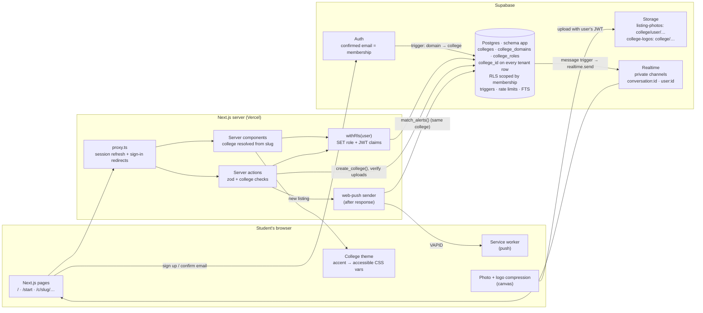
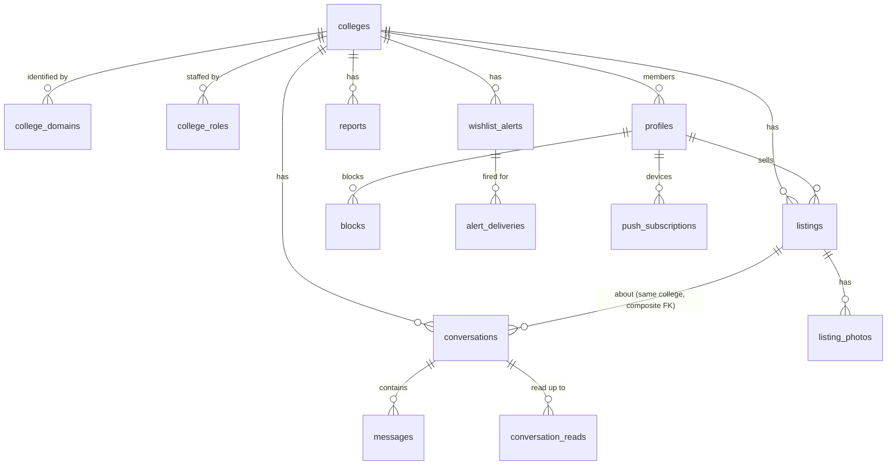

# HandMeDown

A buy, sell and give-away platform where every college gets its own branded marketplace: seniors pass things on, juniors pay less, and nobody's phone number ends up in a WhatsApp group.

**Live demo:** TODO: add the Vercel link after deploying.

## Who is this for and what problem does it solve?

**For:** students of any college. Graduating seniors who are clearing out their rooms, and juniors who need the same things. Any student can set up HandMeDown for their college from the website, without code or config.

**Problem:** every year, seniors throw away or dump useful things: textbooks, cycles, coolers, mattresses, lab coats, scientific calculators. At the same time, juniors buy them new. What selling does happen is in noisy WhatsApp groups:

- there's no search
- photos are scattered across hundreds of messages
- you have to share your phone number with strangers to close a deal

**HandMeDown** gives each campus one place to list items with photos, search them (including books by ISBN), chat in-app without exchanging numbers, and get a notification when the thing you want shows up. Only students with that college's email can post or chat there.

## Screenshots

TODO: add screenshots to `docs/` and link them here:

- the college directory
- "Bring HandMeDown to your college" with its live preview
- two DEMO colleges side by side, showing the different branding
- a listing, the sell form, a chat and alerts
- college Manage and the platform admin page
- both mobile (360 px) and desktop

The design system and the per-college theming rules are documented in [`docs/DESIGN.md`](docs/DESIGN.md).

## Features

- **Many colleges, one platform**
  - Every college lives at `/c/<slug>` with its own name, logo, accent colour, meeting spots and categories.
  - The home page has a searchable directory of colleges, a shortcut to your own college, and "Bring HandMeDown to your college".
  - Each college is fully separate: its chats, alerts and reports are never visible from another college (enforced by Postgres, see Multi-tenancy design).
- **Self-serve onboarding**
  - Sign in with a confirmed college email, fill in name, short name, web address, colour, logo, meeting spots and categories, and watch the live preview update as you go.
  - You become the college's first admin, and classmates on the same email domain join automatically.
  - Public email providers (Gmail, Outlook, Yahoo, iCloud, Proton and others) are refused. If the domain already has a college, you're shown "Your college is already here" with a link to it.
  - College creation is rate-limited in the database.
- **Membership and roles**
  - You're a member of the college whose domain matches your confirmed email (subdomains count). Switching to another college's email is how you transfer.
  - **Platform admin** (from `ADMIN_EMAILS`): suspends colleges, approves extra domains, and sees all reports and usage.
  - **College admin**: branding, meeting spots, categories, extra domains (pending until approved) and the team.
  - **College moderator**: handles their college's reports.
  - Anyone can browse any college. Only verified members of *that* college can post, chat or set alerts there.
- **Per-college theming**
  - Any accent colour a college picks is turned into accessible light and dark shades automatically: WCAG AA text, focus rings and buttons. Colours that fail are nudged in lightness, keeping their hue.
  - The HandMeDown brown and neutrals stay underneath, so the platform stays recognisable.
- **Listings**
  - Up to 5 photos, compressed and resized **on the phone** before upload (1600 px WebP or JPEG plus a 480 px thumbnail), with a live "3.8 MB → 210 KB" readout.
  - Category, condition, price / Free / Exchange, "price when new", and a meeting spot from the college's list.
  - Mark a listing reserved, sold or available again (a rubber stamp lands on the photo), edit it or delete it.
- **Books:** optional ISBN, checksum-validated and normalised to ISBN-13, plus semester, subject and author. Search by ISBN-10 or ISBN-13.
- **Browse and search**
  - Postgres full-text search with prefix matching, filters (category, price range, condition, free, exchange) and sorting.
  - Infinite scroll with **stable keyset pagination**.
  - On mobile, a bottom-sheet filter panel with a live "Show N listings" count.
- **In-app chat**
  - One thread per listing per buyer, real-time over private Supabase Realtime channels.
  - Unread counts, optimistic sending with retry, a warning if you type a phone number, and block/report.
- **Reports:** a reported listing is **hidden immediately** until that college's moderators (or the platform admin) restore it or keep it hidden.
- **Wishlist alerts:** "notify me when a cycle under ₹2,000 is listed" by **web push**, at most once per alert per listing, only within your college.
- **Usage tracking:** a privacy-respecting event table (no IPs, user agents or message content) feeds the honest "N people have used it" number. Demo data is excluded.
- **Every state is designed:** empty, loading skeletons, error with retry, toasts with Undo, a suspended-college banner, and join/transfer gates. Light mode is the default, with a warm dark theme, keyboard support and reduced-motion support.

## Tech stack

Next.js 16 (App Router) · TypeScript (strict) · Tailwind CSS 4 · Prisma 7 (with the `pg` driver adapter) · Supabase Postgres, Auth, Storage and Realtime · zod · web-push · Vitest

## Architecture



**Request path:**

1. `/c/[slug]/layout.tsx` resolves the college and applies its theme.
2. Every user-facing query runs inside `withRls(user, fn)`, which opens a transaction and sets `request.jwt.claims` and `role = authenticated`, the same mechanism Supabase's own API uses.
3. Postgres then enforces the same college-scoped policies on server queries, Storage uploads and Realtime subscriptions.

**Data model** (schema `app`, see `prisma/schema.prisma` and `prisma/migrations`):



**Constraints and indexes** (all in the migrations):

- **Price and content rules:** CHECK constraints for prices, ISBN format, book-only fields, message length, at most 5 photos, slug, accent hex and domain format.
- **Tenant integrity:**
  - Composite foreign keys `(listing_id, college_id)` stop conversations and reports from pointing at another college's listing.
  - Triggers enforce same-college buyer and seller, the college's own categories and meeting spots, and that a listing never changes college.
- **Indexes:**
  - Feed indexes lead with `college_id`: `(college_id, created_at DESC, id DESC)` and `(college_id, category, …)`, partial on visible, unsold listings.
  - A GIN full-text index.
  - Indexes on `college_id` for conversations, reports, alerts and profiles.
- **Unique constraints:**
  - one college per domain (domain is the primary key)
  - one slug per college
  - one chat per buyer per listing
  - one open report per reporter per target
  - one delivery per alert per listing

## Multi-tenancy design

**Choice:** one shared database. Every tenant-owned row carries `college_id`, and Row Level Security scopes every read and write by membership.

**The alternative considered: a separate database (or schema) per college.**

Separate databases give hard isolation and per-college backups, but for this project they would mean:

- **N migrations to run.** Every schema change has to be applied N times.
- **No cross-college view.** The platform admin and the directory would have to query N databases.
- **Free tiers break.** Supabase allows 2 free projects, and every database adds its own connection pool, Auth instance and Storage.
- **Onboarding can't be self-serve.** Provisioning a database from a web form needs infrastructure credentials in the app.

A shared database makes "create a college" a single `INSERT` (`app.create_college()`), and keeps the code and migrations identical for everyone.

**How isolation is enforced (defence in depth):**

1. **Postgres decides membership.** `profiles.college_id` is written only by triggers from the *confirmed* Supabase Auth email (`sync_profile_from_auth`, `recompute_memberships`). No client role can write it.
2. **Every policy checks membership.**
   - Chats, messages, alerts and reports need `app.is_member(college_id)`.
   - Creating things needs `app.can_write(college_id)`: member, and the college is not suspended.
   - Staff actions need `app.is_college_staff(college_id)`, which itself requires membership, so a role in a college you've left is dead.
3. **The schema itself refuses cross-college rows**, even for the owner role: composite foreign keys, plus triggers on conversations and reports.
4. **Storage and Realtime use the same functions.**
   - Photo paths are `<college_id>/<user_id>/<photo>`, and the upload policy compares the folder with `app.my_college()`.
   - Realtime topics are authorized by `app.can_join_topic()` → `app.can_access_conversation()`.
5. **The app layer double-checks**, so users get friendly errors instead of RLS failures. The database is the authority.

The `tests/db/tenant-isolation.test.ts` suite tries every cross-college read and write against the real policies and expects all of them to fail.

**Membership rule and its trade-off:**

- A user belongs to the college whose *active* domain matches their *confirmed* email. They change college by changing their email.
- **Why:** it reuses Supabase's email confirmation as proof, needs no invitations or extra tables, and can't be self-granted.
- **The cost:**
  - One college at a time. Someone with two valid college emails picks one.
  - Transferring moves you, and your old college's chats stay behind (you lose access).
  - A college that shares a domain with another institution can't be split.

  A many-to-many `memberships` table with per-membership email proofs would remove these limits, at the cost of a more complex verification flow.

**What breaks at 1,000 colleges:**

- **Policy cost per row.** `is_member()` / `my_college()` run once per row. They're `STABLE` and index-backed, but very large scans should move membership into JWT custom claims (Supabase Auth hook) so policies compare a claim instead of querying.
- **`recompute_memberships(domain)`** scans `auth.users` filtered by domain, which is fine per domain. The all-users variant (`db:sync`, migrations) would need batching.
- **Directory and admin pages** load all active colleges and need pagination and search on the server.
- **Noisy neighbours.** One big college's traffic shares the same database and connection pool as everyone else's. Per-college rate limits exist for writes, not reads.
- **Supabase free-tier ceilings** (database size, 200 Realtime connections, built-in email limits) are platform-wide, so a few large colleges would force a paid plan or sharding colleges across projects.
- **Moderation.** With 1,000 colleges, abandoned colleges with no active admin would need a platform process (auto-suspend after inactivity, transfer admin).

## Design decisions

1. **Supabase Auth instead of Auth.js.**
   - Row Level Security, Storage policies and Realtime authorization all read the identity from Supabase's JWT (`auth.uid()`).
   - With Auth.js I'd need to mint and sign Supabase-compatible JWTs myself, or give up RLS for Storage and Realtime and re-implement every check in app code.
   - With Supabase Auth, one identity is enforced in one place (Postgres) for the API, file uploads and live chat.
   - Trade-off: I'm tied to Supabase's auth emails and flows, and its free-tier email sending is rate-limited, so production needs custom SMTP.

2. **RLS on server queries too, via `withRls`, not just "the server is trusted".**
   - Prisma normally connects as the table owner and bypasses RLS. I wrap user queries in a transaction that switches to the `authenticated` (or `anon`) role with the caller's claims.
   - A forgotten `where sellerId = me` in app code still can't leak or overwrite data.
   - Trade-off: a few extra statements per request, and every query runs in a short transaction.
   - The settings are transaction-local (`set_config(..., true)`), so this works with Supabase's transaction pooler.
   - Alternatives considered: supabase-js from the server (loses Prisma's typing and migrations), or app-level checks only (one bug away from a leak).

3. **Tables in a private `app` schema.**
   - Supabase exposes `public` through its REST and GraphQL API to anyone with the publishable key. The app never needs that, so the tables live in `app`.
   - The only path to the data is this server, which is where zod validation lives.
   - RLS stays on anyway as defence in depth.
   - Rate limits (listings, messages, chats, reports, alerts) are triggers, so no code path can skip them.

4. **Realtime Broadcast from a database trigger, not Postgres Changes.**
   - Each new message triggers `realtime.send()` to a private `conversation:<id>` topic, plus a small "you have mail" event on `user:<id>` for unread badges.
   - Who may subscribe is an RLS policy on `realtime.messages` (`app.can_join_topic`).
   - Postgres Changes re-checks RLS for every subscriber on every row, which Supabase documents as the part that doesn't scale. Broadcast fans out cheaply.
   - Clients get receive-only access, so all sends go through the validated server action.

5. **Keyset pagination with a tie-breaker, and compression on the client.**
   - Infinite scroll uses `(sort_value, id)` cursors.
   - Created-at cursors keep Postgres' microsecond precision (sent as text), so rows with equal timestamps are never skipped or repeated, and new posts don't shift the page you're on.
   - OFFSET was rejected because it gets slower and duplicates rows as new listings arrive.
   - Photos are shrunk in the browser so uploads work on hostel Wi-Fi and storage stays inside the free tier.
   - The bucket's size and MIME limits, plus a server check of the stored object, mean a modified client still can't push a 20 MB file or someone else's path.

6. **Cache Components off.** Next 16 can prerender a static shell, but nearly every page here depends on the signed-in user. Rendering per request is simpler and fast enough for a campus app.

7. **Shared database + `college_id` + RLS for multi-tenancy.**
   - See [Multi-tenancy design](#multi-tenancy-design).
   - Membership is derived from the confirmed email domain, so there's nothing to invite, approve or forge.
   - Founding a college needs no extra verification email: Supabase's sign-up confirmation already proved the inbox.
   - Email volume is therefore limited by Supabase Auth's own rate limits (sign-up, email change and password reset).
   - College creation (2 per person per day, 30 platform-wide per hour) and extra domain requests (5 pending per college) are rate-limited in the database.

8. **Accessible theming is computed, not hoped for.**
   - `lib/theme.ts` derives every accent shade from the college's colour in OKLCH, moving only lightness until each pairing meets WCAG AA in light and dark.
   - Tests check 200+ random colours plus edge cases (white, black, neon, grey).
   - The alternative (a fixed palette of 8 safe colours) was rejected because colleges care about their exact colour.

## How to run locally

Requires Node 20.9+ and a Supabase project (the free tier is fine).

```bash
cp .env.example .env              # fill in the values (each one is explained in the file)
npm install                       # also generates the Prisma client
npm run vapid:keys                # paste the two keys into .env (for push alerts)
npm run db:setup                  # applies migrations + marks ADMIN_EMAILS as platform admins
npm run db:seed                   # optional: two DEMO colleges with DEMO listings (/c/demo-dit, /c/demo-dce)
npm run dev                       # http://localhost:3000
```

**Supabase dashboard setup (one time):**

- **Authentication → Sign In / Providers → Email:** keep "Confirm email" on.
- **Authentication → URL Configuration:** set the Site URL to your app URL, and add `http://localhost:3000/**` and your production URL to the Redirect URLs.
- **Authentication → Emails → SMTP:** the built-in sender only allows a few emails per hour. For real use, add custom SMTP (for example Resend's free tier).
- **Email change:** if "Secure email change" is on, Supabase asks users to confirm the change from both their old and new address when they verify a college email. Turning it off makes verification one click.

**Platform admin:** sign up, put your email in `ADMIN_EMAILS`, then run `npm run db:sync`.

**Adding a college:** sign up with a college email, confirm it, open `/start` ("Bring HandMeDown to your college") and fill in the form. You become that college's admin; nothing else to configure.

**Tests:**

```bash
npm test          # unit tests: validation, ISBN, image rules, search SQL builder, helpers
npm run test:db   # database tests: RLS, listing permissions, chat access, search, alert matching
```

The database tests run against the database in `DIRECT_URL`, but every test runs inside a transaction that is rolled back, so nothing is left behind.

Other checks: `npm run lint`, `npm run typecheck`, `npm run build`.

## Deploy

**Free tiers:** Vercel (Hobby) for the app and Supabase (Free) for the database, auth, storage and realtime.

1. Push this repo to GitHub and import it in Vercel. The framework (Next.js) is detected automatically.
2. In Vercel → Project → Settings → Environment Variables, add every variable from `.env.example`:
   - `DATABASE_URL`: the pooled connection on port 6543, with `?pgbouncer=true`
   - `DIRECT_URL`: port 5432 (only needed if you run migrations from CI)
   - `NEXT_PUBLIC_SUPABASE_URL`, `NEXT_PUBLIC_SUPABASE_PUBLISHABLE_KEY`, `SUPABASE_SECRET_KEY`
   - `NEXT_PUBLIC_SITE_URL`: your Vercel URL, e.g. `https://handmedown.vercel.app`
   - `ADMIN_EMAILS` (platform admins; colleges themselves are created on the site)
   - `NEXT_PUBLIC_VAPID_PUBLIC_KEY`, `VAPID_PRIVATE_KEY`, `VAPID_SUBJECT`
3. Run the migrations against the production database from your machine: `npm run db:setup` (with `.env` pointing at production).
4. In Supabase → Authentication → URL Configuration, set the Site URL to the Vercel URL and add `https://<your-app>/**` to the Redirect URLs.
5. Deploy. Before sharing it with real students, run `npm run db:unseed` to remove the DEMO colleges and their listings.

## Limitations and what breaks at scale

- **One report hides a listing.** This was a product requirement, and it's abusable: a grudge can hide a legitimate listing until an admin looks. Reports are rate-limited (10 per day) and unique per reporter. The next step would be a threshold, or weighting by reporter history.
- **Search is Postgres FTS with English stemming.** It's great for "calc" or "cycles", but it doesn't fix typos ("calculater") and doesn't handle Hindi or Tamil text. `pg_trgm` or a search service would be next.
- **Web push on iPhone** only works after the student adds the site to their Home Screen (iOS 16.4+). Alerts are still saved, and the page explains this.
- **Alert matching runs right after the request**, using `after()`, in the same serverless function. It's fine for one campus (tens of alerts per listing). For thousands of matches it should move to a queue (Supabase Queues or a cron worker).
- **Chat history** loads the latest 100 messages per thread. There's no "load older" yet.
- **Abandoned uploads.** If someone uploads photos and closes the tab without posting, the files stay in Storage until a clean-up job runs. Cancel and edit do remove their own leftovers.
- **Each request opens a short transaction** (because of `withRls`). On Supabase's free pooler, a big traffic spike would hit connection limits before CPU limits.
- **Email verification proves inbox access, not enrolment.** Alumni keep their college email for a while.
- **One college per person** (membership follows the email). Transferring leaves your old college's chats behind. See Multi-tenancy design for what changes at 1,000 colleges.
- **College domains are self-declared** for the first domain. Anyone with a confirmed `@x.ac.in` email can found the college for `x.ac.in`. A takeover dispute needs the platform admin (suspend, then fix by hand). Extra domains do need approval.
- **Not reviewed by a person yet:** custom accent colours are checked automatically for contrast, but uploaded logos aren't moderated.
- **Free-tier ceilings:** 500 MB of database, 1 GB of storage (about 5,000 listings at 5 compressed photos each), 200 concurrent Realtime connections, and Supabase's built-in email rate limit.

## What I learned

- How Supabase actually enforces RLS (`request.jwt.claims` + `SET ROLE`), and that you can reuse the same mechanism from your own server to make policies the single source of truth.
- Keyset pagination is easy to get subtly wrong: JS `Date` drops Postgres' microseconds, which silently skips rows that share a timestamp. Testing with deliberately identical timestamps caught it.
- Realtime authorization in Supabase is just another RLS policy, on `realtime.messages`. Broadcast from a trigger is simpler and cheaper than Postgres Changes for chat.
- Small spring physics (a 70-line integrator) makes a UI feel crafted without a heavy animation library, provided reduced-motion users get instant transitions.

## What I'd improve next

- Typo-tolerant search (trigram similarity) and "similar listings" on the detail page.
- A reputation signal for reports and sellers (handed-down count already exists), so one report doesn't hide a listing from a trusted seller.
- Message pagination, read receipts and image messages in chat.

---

**GitHub "About":** Multi-college student marketplace: every campus gets its own branded HandMeDown where seniors hand down books, cycles and hostel gear. Tenant-isolated with Postgres RLS. Next.js + Supabase.

**Suggested topics:** `nextjs` · `supabase` · `multi-tenant` · `row-level-security` · `marketplace`
