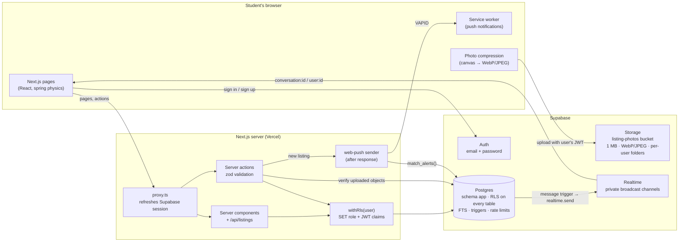
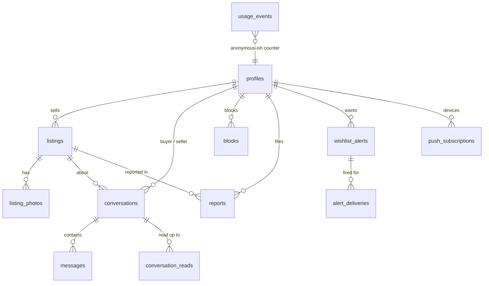

# HandMeDown

A buy, sell and give-away marketplace for the students of one college: seniors pass things on, juniors pay less, and nobody's phone number ends up in a WhatsApp group.

**Live demo:** TODO: add the Vercel link after deploying.

## Who is this for and what problem does it solve?

**For:** students of a single college. Graduating seniors who are clearing out their rooms, and juniors who need the same things.

**Problem:** every year, seniors throw away or dump useful things: textbooks, cycles, coolers, mattresses, lab coats, scientific calculators. At the same time, juniors buy them new. What selling does happen is in noisy WhatsApp groups:

- there's no search
- photos are scattered across hundreds of messages
- you have to share your phone number with strangers to close a deal

**HandMeDown** gives the campus one place to list items with photos, search them (including books by ISBN), chat in-app without exchanging numbers, and get a notification when the thing you want shows up.

## Screenshots

TODO: add screenshots to `docs/` (home, listing, sell, chat, alerts, admin; mobile and desktop) and link them here.

The approved design concept and its tokens are documented in [`docs/DESIGN.md`](docs/DESIGN.md).

## Features

- **Accounts**
  - Email and password sign-up, sign-in and password reset (Supabase Auth).
  - A **Verified student** badge for anyone who confirms an email on an allowed college domain. Subdomains such as `cse.college.edu.in` count too.
  - Unverified accounts can browse and chat, but can't post.
- **Listings**
  - Up to 5 photos per listing. Photos are compressed and resized **on the phone** before upload (1600 px WebP or JPEG, plus a 480 px thumbnail), with a live "3.8 MB → 210 KB" readout.
  - Categories, condition, price / Free / Exchange, "price when new" so buyers see the saving, and a pickup spot on campus.
  - Mark a listing reserved, sold or available again (a rubber stamp lands on the photo). You can also edit or delete it.
- **Books**
  - Optional ISBN, checksum-validated and normalised to ISBN-13, plus semester, subject and author.
  - Search by ISBN-10 or ISBN-13, with or without hyphens.
- **Browse and search**
  - Postgres full-text search with prefix matching, so it finds results while you type.
  - Filters for category, price range, condition, free-only and exchange-only. Sort by newest or by price.
  - Infinite scroll with **stable keyset (cursor) pagination**.
  - On mobile, a bottom-sheet filter panel shows a live "Show N listings" count.
- **In-app chat**
  - One thread per listing per buyer, with the listing pinned at the top. Messages arrive in real time over private Supabase Realtime channels.
  - Unread counts on the tab bar and in the inbox. Sending is optimistic, with retry if a message fails.
  - A warning appears if you type a phone number.
  - You can block and report people.
- **Reports**
  - A reported listing is **hidden immediately**, pending admin review.
  - The admin view lets you restore, keep hidden, dismiss or ban.
- **Wishlist alerts**
  - For example, "notify me when a cycle under ₹2,000 is listed".
  - Delivered by **web push**, at most once per alert per listing.
  - The home page box understands phrases like "cycle under 2000" and pre-fills the form.
- **Usage tracking**
  - A privacy-respecting event table: no IPs, no user agents, no message content.
  - Feeds the admin page's "N people have used it" number. Demo data is excluded.
- **Every state is designed:** empty, loading skeletons, error with retry, success toasts with Undo. Light mode is the default. There's a warm dark theme, keyboard support and reduced-motion support.

## Tech stack

Next.js 16 (App Router) · TypeScript (strict) · Tailwind CSS 4 · Prisma 7 (with the `pg` driver adapter) · Supabase Postgres, Auth, Storage and Realtime · zod · web-push · Vitest

## Architecture



**Request path:**

1. Every user-facing query runs inside `withRls(user, fn)`.
2. That opens a transaction and runs `set_config('request.jwt.claims', …)` and `set_config('role', 'authenticated')`, the same mechanism Supabase's own API uses.
3. Postgres then enforces the same RLS policies on server queries that it enforces on Storage uploads and Realtime subscriptions.

**Data model** (schema `app`, see `prisma/schema.prisma` and `prisma/migrations`):



**Constraints and indexes** (all in the migrations):

- CHECK constraints for the price rules, the ISBN format, book fields only on books, 1–2000 character messages, at most 5 photos per listing, no self-chat and no self-block.
- A GIN index on a generated `tsvector`.
- Partial feed indexes on `(created_at DESC, id DESC)` and `(category, created_at DESC, id DESC)`, covering only visible, unsold listings.
- Unique constraints: one chat per buyer per listing, one open report per reporter per target, one delivery per alert per listing.

## Design decisions

1. **Supabase Auth instead of Auth.js.**
   - Row Level Security, Storage policies and Realtime authorization all read the identity from Supabase's JWT (`auth.uid()`).
   - With Auth.js I'd need to mint and sign Supabase-compatible JWTs myself, or give up RLS for Storage and Realtime and re-implement every check in app code.
   - With Supabase Auth, one identity is enforced in one place (Postgres) for the API, file uploads and live chat.
   - Trade-off: I'm tied to Supabase's auth emails and flows, and its free-tier email sending is rate-limited, so production needs custom SMTP.

2. **RLS on server queries too, via `withRls`, not just "the server is trusted".**
   - Prisma normally connects as the table owner and bypasses RLS. I wrap user queries in a transaction that switches to the `authenticated` (or `anon`) role with the caller's claims.
   - A forgotten `where sellerId = me` in app code still can't leak or overwrite data.
   - Trade-off: a few extra statements per request, and every query runs in a short transaction.
   - The settings are transaction-local (`set_config(..., true)`), so this works with Supabase's transaction pooler.
   - Alternatives considered: supabase-js from the server (loses Prisma's typing and migrations), or app-level checks only (one bug away from a leak).

3. **Tables in a private `app` schema.**
   - Supabase exposes `public` through its REST and GraphQL API to anyone with the publishable key. The app never needs that, so the tables live in `app`.
   - The only path to the data is this server, which is where zod validation lives.
   - RLS stays on anyway as defence in depth.
   - Rate limits (listings, messages, chats, reports, alerts) are triggers, so no code path can skip them.

4. **Realtime Broadcast from a database trigger, not Postgres Changes.**
   - Each new message triggers `realtime.send()` to a private `conversation:<id>` topic, plus a small "you have mail" event on `user:<id>` for unread badges.
   - Who may subscribe is an RLS policy on `realtime.messages` (`app.can_join_topic`).
   - Postgres Changes re-checks RLS for every subscriber on every row, which Supabase documents as the part that doesn't scale. Broadcast fans out cheaply.
   - Clients get receive-only access, so all sends go through the validated server action.

5. **Keyset pagination with a tie-breaker, and compression on the client.**
   - Infinite scroll uses `(sort_value, id)` cursors.
   - Created-at cursors keep Postgres' microsecond precision (sent as text), so rows with equal timestamps are never skipped or repeated, and new posts don't shift the page you're on.
   - OFFSET was rejected because it gets slower and duplicates rows as new listings arrive.
   - Photos are shrunk in the browser so uploads work on hostel Wi-Fi and storage stays inside the free tier.
   - The bucket's size and MIME limits, plus a server check of the stored object, mean a modified client still can't push a 20 MB file or someone else's path.

6. **Cache Components off.** Next 16 can prerender a static shell, but nearly every page here depends on the signed-in user. Rendering per request is simpler and fast enough for a campus app.

## How to run locally

Requires Node 20.9+ and a Supabase project (the free tier is fine).

```bash
cp .env.example .env              # fill in the values (each one is explained in the file)
npm install                       # also generates the Prisma client
npm run vapid:keys                # paste the two keys into .env (for push alerts)
npm run db:setup                  # applies migrations + syncs college domains and admins
npm run db:seed                   # optional: adds clearly labelled DEMO listings
npm run dev                       # http://localhost:3000
```

**Supabase dashboard setup (one time):**

- **Authentication → Sign In / Providers → Email:** keep "Confirm email" on.
- **Authentication → URL Configuration:** set the Site URL to your app URL, and add `http://localhost:3000/**` and your production URL to the Redirect URLs.
- **Authentication → Emails → SMTP:** the built-in sender only allows a few emails per hour. For real use, add custom SMTP (for example Resend's free tier).
- **Email change:** if "Secure email change" is on, Supabase asks users to confirm the change from both their old and new address when they verify a college email. Turning it off makes verification one click.

**Making yourself admin:** sign up, put your email in `ADMIN_EMAILS`, then run `npm run db:sync`.

**Tests:**

```bash
npm test          # unit tests: validation, ISBN, image rules, search SQL builder, helpers
npm run test:db   # database tests: RLS, listing permissions, chat access, search, alert matching
```

The database tests run against the database in `DIRECT_URL`, but every test runs inside a transaction that is rolled back, so nothing is left behind.

Other checks: `npm run lint`, `npm run typecheck`, `npm run build`.

## Deploy

**Free tiers:** Vercel (Hobby) for the app and Supabase (Free) for the database, auth, storage and realtime.

1. Push this repo to GitHub and import it in Vercel. The framework (Next.js) is detected automatically.
2. In Vercel → Project → Settings → Environment Variables, add every variable from `.env.example`:
   - `DATABASE_URL`: the pooled connection on port 6543, with `?pgbouncer=true`
   - `DIRECT_URL`: port 5432 (only needed if you run migrations from CI)
   - `NEXT_PUBLIC_SUPABASE_URL`, `NEXT_PUBLIC_SUPABASE_PUBLISHABLE_KEY`, `SUPABASE_SECRET_KEY`
   - `NEXT_PUBLIC_SITE_URL`: your Vercel URL, e.g. `https://handmedown.vercel.app`
   - `NEXT_PUBLIC_COLLEGE_NAME`, `NEXT_PUBLIC_COLLEGE_SHORT`, `COLLEGE_EMAIL_DOMAINS`, `ADMIN_EMAILS`
   - `NEXT_PUBLIC_VAPID_PUBLIC_KEY`, `VAPID_PRIVATE_KEY`, `VAPID_SUBJECT`
3. Run the migrations against the production database from your machine: `npm run db:setup` (with `.env` pointing at production).
4. In Supabase → Authentication → URL Configuration, set the Site URL to the Vercel URL and add `https://<your-app>/**` to the Redirect URLs.
5. Deploy. Before sharing it with real students, run `npm run db:unseed` to remove the demo listings.

## Limitations and what breaks at scale

- **One report hides a listing.** This was a product requirement, and it's abusable: a grudge can hide a legitimate listing until an admin looks. Reports are rate-limited (10 per day) and unique per reporter. The next step would be a threshold, or weighting by reporter history.
- **Search is Postgres FTS with English stemming.** It's great for "calc" or "cycles", but it doesn't fix typos ("calculater") and doesn't handle Hindi or Tamil text. `pg_trgm` or a search service would be next.
- **Web push on iPhone** only works after the student adds the site to their Home Screen (iOS 16.4+). Alerts are still saved, and the page explains this.
- **Alert matching runs right after the request**, using `after()`, in the same serverless function. It's fine for one campus (tens of alerts per listing). For thousands of matches it should move to a queue (Supabase Queues or a cron worker).
- **Chat history** loads the latest 100 messages per thread. There's no "load older" yet.
- **Abandoned uploads.** If someone uploads photos and closes the tab without posting, the files stay in Storage until a clean-up job runs. Cancel and edit do remove their own leftovers.
- **Each request opens a short transaction** (because of `withRls`). On Supabase's free pooler, a big traffic spike would hit connection limits before CPU limits.
- **Email verification proves inbox access, not enrolment.** Alumni keep their college email for a while.
- **Free-tier ceilings:** 500 MB of database, 1 GB of storage (about 5,000 listings at 5 compressed photos each), 200 concurrent Realtime connections, and Supabase's built-in email rate limit.

## What I learned

- How Supabase actually enforces RLS (`request.jwt.claims` + `SET ROLE`), and that you can reuse the same mechanism from your own server to make policies the single source of truth.
- Keyset pagination is easy to get subtly wrong: JS `Date` drops Postgres' microseconds, which silently skips rows that share a timestamp. Testing with deliberately identical timestamps caught it.
- Realtime authorization in Supabase is just another RLS policy, on `realtime.messages`. Broadcast from a trigger is simpler and cheaper than Postgres Changes for chat.
- Small spring physics (a 70-line integrator) makes a UI feel crafted without a heavy animation library, provided reduced-motion users get instant transitions.

## What I'd improve next

- Typo-tolerant search (trigram similarity) and "similar listings" on the detail page.
- A reputation signal for reports and sellers (handed-down count already exists), so one report doesn't hide a listing from a trusted seller.
- Message pagination, read receipts and image messages in chat.

---

**GitHub "About":** Campus marketplace where graduating seniors hand down books, cycles and hostel gear to juniors. In-app chat, ISBN search, push alerts. Next.js + Supabase.

**Suggested topics:** `nextjs` · `supabase` · `row-level-security` · `marketplace` · `realtime-chat`
